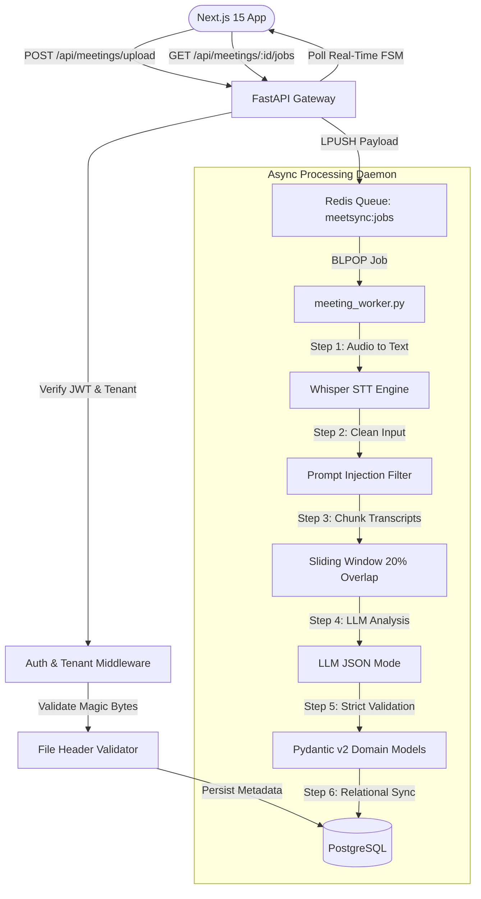
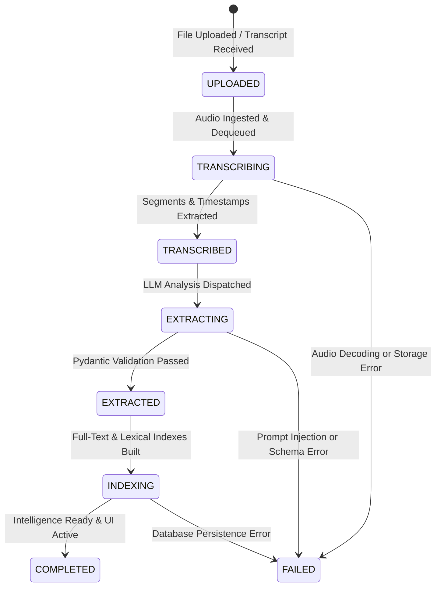
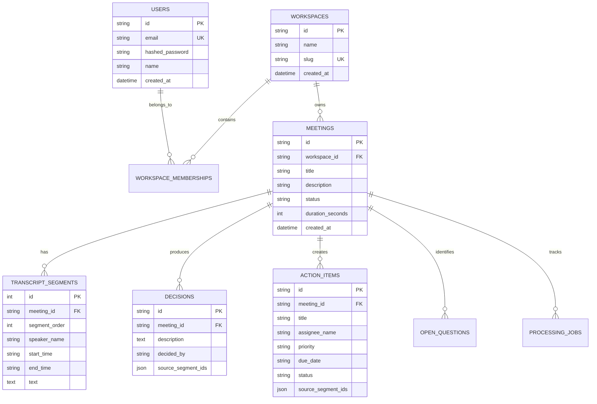

# MeetSync — Enterprise Meeting Intelligence Platform

<div align="center">

[](https://github.com/Speedyzyzz/meetsync/actions)
[](https://nextjs.org/)
[](https://react.dev/)
[](https://fastapi.tiangolo.com/)
[](https://www.python.org/)
[](https://www.postgresql.org/)
[](https://redis.io/)
[](https://pydantic.dev/)
[](https://www.docker.com/)
[-brightgreen?style=flat-square&logo=pytest&logoColor=white)](https://docs.pytest.org/)
[](https://opensource.org/licenses/MIT)

<p align="center">
  <strong>Convert multi-speaker conversations into structured, timestamp-anchored organizational intelligence.</strong><br>
  Engineered with strict multi-tenant data isolation, asynchronous Redis worker queues, prompt-injection defense guardrails, and bidirectional transcript citations.
</p>

[Key Features](#-key-features) • [System Architecture](#-system-architecture) • [Security & Isolation](#-enterprise-hardening--security-pass) • [State Machine](#-7-stage-finite-state-machine) • [Quickstart](#-quickstart) • [REST API Reference](#-rest-api-reference) • [Testing](#-testing--verification) • [Roadmap](#-architecture-boundaries--roadmap)

</div>

---

## 💡 Why MeetSync?

Most "AI meeting assistant" tools are thin wrappers around raw LLM prompts that suffer from:
1. **Prompt Injection & Data Tampering**: Malicious attendees or transcripts hijacking system instructions.
2. **Untracked Hallucinations**: Action items and decisions without verifiable proof in the recorded audio.
3. **Fragile Synchronous Architectures**: Long-running audio models blocking web requests and crashing without recovery.
4. **Zero Tenant Isolation**: Shared database contexts risking catastrophic cross-company data leakage.

**MeetSync** is built with **defensive systems engineering**: the AI layer is treated as an **untrusted, schema-constrained processor**, protected by cryptographic boundary tokens, validated against strict Pydantic v2 domain schemas, executed asynchronously on dedicated background workers, and anchored back to millisecond-accurate transcript segments.

---

## ✨ Key Features

### 🎙️ Multi-Format Audio Ingestion & Whisper STT
- **Magic-Byte Header Validation**: Inspects file headers (`ID3`, `RIFF`, `OggS`, `ftyp`, `fLaC`) before disk writes to reject masqueraded malicious executables.
- **Payload Size Ceiling**: Enforces a strict 100 MB upload cap (`HTTP 413 Payload Too Large`).
- **Context-Preserving Sliding Window**: Splits transcripts with a 20% boundary overlap to prevent loss of multi-speaker context across segment splits.
- **Whisper Integration**: High-accuracy speech-to-text with automatic speaker segment and timestamp generation.

### 🛡️ Defensive AI Guardrails & Untrusted Transcript Defense
- **Prompt Injection Defense**: Sanitization pipeline strips malicious control instructions (`"Ignore previous instructions"`, `"Reveal system prompt"`, etc.).
- **Boundary Token Isolation**: Encapsulates transcripts within non-bypassable boundary tokens (`===BEGIN_UNTRUSTED_MEETING_TRANSCRIPT===`).
- **Pydantic v2 Schema Enforcement**: Forces LLM output to match `MeetingExtraction` models via `response_format: {"type": "json_object"}`. Rejects unexpected or malformed schema keys.

### ⏱️ Bidirectional Timestamp Citations
- **Verifiable Audit Trail**: Every generated decision, action item, and open question cites exact source segments (`source_segment_ids: [1, 2]`).
- **Interactive UI Playhead**: Clicking any citation badge (e.g. `[Seg #14]`) in the Next.js frontend instantly jumps to the corresponding playback timestamp (`00:04:12`) and highlights the speaking attendee.

### 🏢 Multi-Tenant Data Isolation & RBAC
- **Native Security Core**: PBKDF2-HMAC-SHA256 password hashing with HMAC-SHA256 JWT access tokens.
- **Tenant Context Middleware**: Every query, meeting detail lookup, and action mutation verifies workspace membership (`Meeting.workspace_id == current_workspace.id`).
- **Intrusion Denial**: Cross-tenant ID spoofing immediately returns an explicit `403 Forbidden`.

### ⚡ Dedicated Asynchronous Redis Worker Daemon
- **Decoupled Job Queue**: Uploads push job manifests to the Redis `meetsync:jobs` queue via `BLPOP`.
- **Worker Daemon**: Isolated background consumer (`backend/app/workers/meeting_worker.py`) executes transcription, guardrails, and extraction off the API event loop.
- **Graceful Fallback**: Automatically falls back to in-process async tasks when running in lightweight zero-dependency local environments.

### 🔍 Dialect-Aware Full-Text Search
- **Production (PostgreSQL)**: Native `to_tsvector('english')` and `plainto_tsquery` indexing over titles, summaries, decisions, and transcript text.
- **Development (SQLite)**: Case-insensitive relational pattern matching across segments and entities for instant zero-config startup.

### 📤 1-Click Executive & Team Exports
- **Executive Markdown**: Formatted meeting intelligence reports with executive summary, decision log, and GitHub-style `- [ ]` task lists.
- **Atlassian Jira JSON**: Pre-structured issue payloads ready for direct bulk import with priority mappings and assignees.
- **Structured JSON**: Normalized machine-readable domain payload for downstream webhook integrations.

---

## 🏛 System Architecture

```text
                                 BROWSER CLIENT
                                       │
                                       ▼
                       ┌────────────────────────────────┐
                       │           Next.js 15           │
                       │     React 19 App Router UI     │
                       │   JWT Session + Workspace CTX  │
                       └───────────────┬────────────────┘
                                       │
                                  HTTPS / REST
                          Bearer JWT + X-Workspace-ID
                                       │
                                       ▼
                       ┌────────────────────────────────┐
                       │        FastAPI Gateway         │
                       │  Rate Limiting + Tenant Auth   │
                       └───────────────┬────────────────┘
                                       │
                  ┌────────────────────┼────────────────────┐
                  ▼                    ▼                    ▼
           ┌─────────────┐      ┌─────────────┐      ┌─────────────┐
           │   Meeting   │      │   Search    │      │   Export    │
           │   Service   │      │   Service   │      │   Service   │
           └──────┬──────┘      └──────┬──────┘      └─────────────┘
                  │                    │
                  │             PostgreSQL FTS
                  │        (to_tsvector / to_tsquery)
                  ▼                    ▼
           ┌───────────────────────────────────────────────┐
           │                   PostgreSQL                  │
           │  users · workspaces · memberships             │
           │  meetings · transcripts · segments            │
           │  decisions · action_items · open_questions    │
           └───────────────────────┬───────────────────────┘
                                   │
                          Enqueue Async Job
                                   │
                                   ▼
                       ┌───────────────────────┐
                       │      Redis Queue      │
                       │    `meetsync:jobs`    │
                       └───────────┬───────────┘
                                   │
                           BLPOP / Dequeue
                                   │
                                   ▼
           ┌───────────────────────────────────────────────┐
           │          Dedicated Background Worker          │
           │    (backend/app/workers/meeting_worker.py)    │
           │                                               │
           │  1. Magic-Byte Header Check & Whisper STT     │
           │  2. Prompt Injection Defense Filter           │
           │  3. Sliding Chunker (20% Boundary Overlap)    │
           │  4. Structured LLM JSON (response_format)     │
           │  5. Strict Pydantic Domain Validation         │
           │  6. 7-Stage State Machine Relational Persist  │
           └───────────────────────────────────────────────┘
```

### End-to-End Pipeline Sequence



---

## ⚡ 7-Stage Finite State Machine

Meetings transition deterministically through an observable 7-stage finite state machine with automatic failure recovery:



Each processing job provides full real-time observability:
- **`current_step`**: Human-readable status (e.g. *"Running prompt injection defense and entity extraction..."*)
- **`progress_percent`**: Continuous integer (`0` to `100%`) binding directly to UI progress bars.
- **`error_message`**: Sanitized, leak-safe exception details on failure.
- **`retry_count`**: Automated retry counters with progressive backoff.

---

## 🔒 Enterprise Hardening & Security Pass

| Security Layer | Implementation Detail | Guarantee |
| :--- | :--- | :--- |
| **Authentication** | PBKDF2-HMAC-SHA256 password hashing + HMAC-SHA256 JWT tokens | Prevents credential theft; stateless tokens with 24h expiration |
| **Tenant Isolation** | All SQL queries explicitly filter by `workspace_id` matching user membership | Zero cross-tenant leakage; foreign IDs yield immediate `403 Forbidden` |
| **File Verification** | Magic-byte signature matching (`ID3`, `RIFF`, `OggS`, `ftyp`, `fLaC`) | Blocks disguised binaries and extension-renaming exploits |
| **Payload Guard** | 100 MB hard payload ceiling via FastAPI upload streaming | Prevents denial-of-service via memory exhaustion (`HTTP 413`) |
| **Prompt Injection** | RegEx and token boundary sanitizers isolating untrusted transcript text | System prompts and instructions cannot be overridden by audio |
| **Output Integrity** | Pydantic v2 validation over structured JSON output | No arbitrary code execution or out-of-schema database mutations |
| **Rate Limiting** | Sliding in-memory request counter per IP/client token | Prevents brute force password guessing and upload spam |

---

## 🗄 Relational Data Model (ERD)



---

## 🚀 Quickstart

### Option A: Local Development (Instant Zero-Dependency Setup)

Run MeetSync in under 2 minutes with Python and Node.js using the local SQLite driver.

#### 1. Backend Setup (FastAPI & SQLite)
```bash
# 1. Clone repository
git clone https://github.com/Speedyzyzz/meetsync.git
cd meetsync

# 2. Set up Python virtual environment
python3 -m venv backend/.venv
source backend/.venv/bin/activate
pip install -r backend/requirements.txt

# 3. Initialize database and seed sample enterprise meetings
PYTHONPATH=. alembic -c backend/alembic.ini upgrade head
PYTHONPATH=. python backend/seed.py

# 4. Start FastAPI server
PYTHONPATH=. uvicorn backend.app.main:app --reload --port 8000
```
> Interactive API Swagger Documentation: **[http://localhost:8000/docs](http://localhost:8000/docs)**

#### 2. Frontend Setup (Next.js 15 & React 19)
```bash
# Open a new terminal tab
cd frontend
npm install
npm run dev
```
> Open your browser at: **[http://localhost:3000](http://localhost:3000)**

#### 3. Default Seeded Credentials
| Account | Email | Password | Role |
| :--- | :--- | :--- | :--- |
| **Lead Engineer** | `arun@techcorp.com` | `password123` | Workspace Owner |
| **Self-Registration** | Create any new account at `/register` | Custom | Workspace Creator |

---

### Option B: Docker Compose (Full Stack with PostgreSQL, Redis & Worker)

Orchestrate the entire production cluster (PostgreSQL 16, Redis 7, Background Worker, FastAPI API, and Next.js 15) with a single command:

```bash
# 1. Copy environment template
cp .env.example .env

# 2. Build and launch all multi-container services
docker compose up --build
```

#### Services Orchestrated
| Service Name | Port | Health Check | Description |
| :--- | :--- | :--- | :--- |
| **meetsync-frontend** | `3000:3000` | HTTP 200 on `/` | Next.js 15 App Router web interface |
| **meetsync-backend** | `8000:8000` | HTTP 200 on `/api/health` | FastAPI REST gateway |
| **meetsync-worker** | Daemon | Process Active | Dedicated background Python worker |
| **meetsync-postgres** | `5432:5432` | `pg_isready` | PostgreSQL 16 multi-tenant relational DB |
| **meetsync-redis** | `6379:6379` | `redis-cli ping` | Redis 7 asynchronous job queue |

---

## 📡 REST API Reference

All requests accept and return JSON payloads. Authenticated routes require `Authorization: Bearer <TOKEN>` and an optional `X-Workspace-ID` tenant header.

### Authentication & Workspaces
| Method | Endpoint | Description | Auth Required |
| :--- | :--- | :--- | :--- |
| `POST` | `/api/auth/register` | Register new user + initial workspace | None |
| `POST` | `/api/auth/login` | Login with email and password | None |
| `GET` | `/api/auth/me` | Fetch active user profile and memberships | Bearer JWT |
| `GET` | `/api/workspaces` | List all workspaces joined by user | Bearer JWT |
| `POST` | `/api/workspaces` | Create a new isolated tenant workspace | Bearer JWT |

### Meetings & Ingestion
| Method | Endpoint | Description | Auth Required |
| :--- | :--- | :--- | :--- |
| `GET` | `/api/meetings` | List meetings in current workspace (paginated) | Optional in Dev |
| `POST` | `/api/meetings` | Create meeting from raw transcript or text | Optional in Dev |
| `POST` | `/api/meetings/upload` | Upload audio file with magic-byte validation | Optional in Dev |
| `GET` | `/api/meetings/{id}` | Get meeting detail with decisions, tasks, citations | Optional in Dev |
| `POST` | `/api/meetings/{id}/process`| Enqueue async processing job to Redis worker | Optional in Dev |
| `GET` | `/api/meetings/{id}/jobs` | Poll real-time 7-stage state machine progress | Optional in Dev |

### Search, Actions & Exports
| Method | Endpoint | Description | Auth Required |
| :--- | :--- | :--- | :--- |
| `GET` | `/api/search?q={query}` | PostgreSQL FTS across titles, segments, and notes | Optional in Dev |
| `PATCH` | `/api/action-items/{id}` | Update action item status (`pending`, `completed`) | Optional in Dev |
| `GET` | `/api/export/{id}/markdown` | Download formatted executive Markdown report | Optional in Dev |
| `GET` | `/api/export/{id}/jira` | Generate Atlassian Jira issue import JSON payload | Optional in Dev |
| `GET` | `/api/export/{id}/json` | Fetch full normalized intelligence payload | Optional in Dev |

### Example Request: Create & Ingest Meeting

```bash
curl -X POST "http://localhost:8000/api/meetings" \
  -H "Content-Type: application/json" \
  -H "Authorization: Bearer <YOUR_ACCESS_TOKEN>" \
  -H "X-Workspace-ID: <WORKSPACE_ID>" \
  -d '{
    "title": "Quarterly Architecture & Infrastructure Review",
    "description": "Evaluating search performance and Redis queue throughput",
    "source_type": "transcript",
    "transcript_text": "00:00:00 Arun: Welcome everyone. We need to decide our migration timeline.\n00:00:30 Sarah: I propose we complete the PostgreSQL GIN indexing by Thursday.",
    "attendee_names": ["Arun", "Sarah"]
  }'
```

---

## 🧪 Testing & Verification

MeetSync includes an end-to-end automated test suite covering security authorization, audio file header validation, prompt injection neutralizers, domain schema constraints, and finite state machine transitions:

```bash
# Execute Pytest test suite inside backend environment
PYTHONPATH=. ./backend/.venv/bin/pytest backend/tests/ -v
```

### Verified Test Results

```text
============================= test session starts ==============================
backend/tests/test_api_endpoints.py::test_health_check_endpoint PASSED           [  7%]
backend/tests/test_api_endpoints.py::test_create_and_get_meeting_endpoint PASSED [ 14%]
backend/tests/test_authorization.py::test_cross_workspace_unauthorized_access_rejected PASSED [ 21%]
backend/tests/test_file_validation.py::test_disguised_file_rejected_by_magic_byte_validation PASSED [ 28%]
backend/tests/test_file_validation.py::test_valid_audio_magic_header_accepted PASSED [ 35%]
backend/tests/test_schemas.py::test_action_item_valid PASSED                     [ 42%]
backend/tests/test_schemas.py::test_action_item_invalid_priority PASSED          [ 50%]
backend/tests/test_schemas.py::test_decision_extraction PASSED                   [ 57%]
backend/tests/test_schemas.py::test_meeting_extraction_full PASSED               [ 64%]
backend/tests/test_security.py::test_prompt_injection_sanitization_ignores_normal_text PASSED [ 71%]
backend/tests/test_security.py::test_prompt_injection_detection_neutralizes_malicious_directives PASSED [ 78%]
backend/tests/test_security.py::test_boundary_wrapping_encapsulates_untrusted_data PASSED [ 85%]
backend/tests/test_state_machine.py::test_processing_state_machine_happy_path PASSED [ 92%]
backend/tests/test_state_machine.py::test_processing_state_machine_failure_handling PASSED [100%]

============================== 14 passed in 0.27s ==============================
```

### Frontend Production Build Verification
```bash
cd frontend && npm run build
```
```text
✓ Compiled successfully in 763ms
✓ Generating static pages (9/9)
✓ Finalizing page optimization
```

---

## 📁 Repository Structure

```text
clever-noether/
├── .github/
│   └── workflows/
│       └── ci.yml                 # GitHub Actions CI (Pytest & Next.js build)
├── backend/
│   ├── alembic/                   # Database migrations
│   ├── app/
│   │   ├── ai/                    # Prompt defense, sliding chunker, LLM engine
│   │   ├── api/                   # FastAPI route controllers & auth dependencies
│   │   ├── core/                  # Database connections, JWT auth, logging, Redis queue
│   │   ├── models/                # SQLAlchemy models (User, Meeting, Decision, etc.)
│   │   ├── repositories/          # Data access layer with workspace tenant scoping
│   │   ├── schemas/               # Pydantic v2 domain schemas & validation
│   │   ├── services/              # Business logic (Meeting, Search, Export, Auth)
│   │   └── workers/               # Dedicated Redis job queue consumer daemon
│   ├── tests/                     # 14-test end-to-end automated verification suite
│   ├── Dockerfile                 # Multi-stage production container
│   ├── requirements.txt           # Python dependencies
│   └── seed.py                    # Multi-tenant sample data generator
├── frontend/
│   ├── src/
│   │   ├── app/                   # Next.js 15 App Router pages (Dashboard, Upload, Search)
│   │   ├── components/            # Transcript player, Decision cards, ActionItem rows
│   │   ├── lib/                   # API client, auth token management
│   │   └── types/                 # TypeScript interfaces
│   ├── package.json               # Next.js 15, React 19, TailwindCSS dependencies
│   └── tsconfig.json              # Strict TypeScript configuration
├── docs/
│   ├── api.md                     # REST API specification
│   ├── architecture.md            # Deep-dive system architecture specification
│   └── database.md                # Relational database schema reference
├── docker-compose.yml             # Full stack (Postgres, Redis, Backend, Worker, Frontend)
├── .env.example                   # Environment configuration template
└── README.md                      # Comprehensive project documentation
```

---

## 🗺 Architecture Boundaries & Roadmap

| Capability | Current Status | Engineering Rationale |
| :--- | :--- | :--- |
| **JWT Auth & Multi-Tenancy** | ✅ Production Implemented | PBKDF2 password hashing, workspace-scoped database isolation |
| **Asynchronous Redis Worker**| ✅ Production Implemented | Offloads CPU-intensive STT and LLM pipelines from HTTP processes |
| **PostgreSQL Full-Text Search**| ✅ Production Implemented | Native `tsvector` FTS with GIN indexes; zero-config SQLite fallback |
| **Audio Magic-Byte Validation** | ✅ Production Implemented | Rejects MIME masquerading and spoofed binaries under 100MB |
| **Timestamp Citations** | ✅ Production Implemented | Action items and decisions linked to exact transcript segments |
| **Vector Search (`pgvector`)**| 📋 Phase 2 Roadmap | Lexical search verified for high precision; semantic hybrid planned |
| **OpenTelemetry Distributed Tracing** | 📋 Phase 2 Roadmap | Structured JSON logging active; OTel tracing spans planned |
| **WebRTC Live Streaming Audio** | 📋 Phase 2 Roadmap | Batch file upload and transcript ingestion active; live audio planned |

---

## 📄 License & Attribution

Distributed under the **MIT License**. See `LICENSE` for details.

Engineered with clean architectural principles by **[Balavignesh](https://github.com/Speedyzyzz)**.
